<p align="center">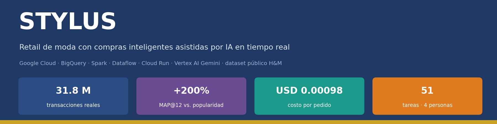</p>

<p align="center">
  <a href="https://github.com/estuardoo/STYLUS/actions/workflows/ci.yml"></a>
  
  
  
  
  
  
  
</p>

<p align="center"><b>UTEC · Taller de Arquitectura Big Data · Proyecto final</b><br>
Plataforma Big Data en Google Cloud que convierte el histórico público de compras de H&M en <b>analítica</b>, <b>recomendaciones personalizadas</b> y una <b>tienda web con asistente de IA</b>.</p>

<p align="center">
  <a href="docs/entrega1/Guia_Tecnica_STYLUS.pdf">📘 Guía técnica (44 págs.)</a> ·
  <a href="docs/entrega1/Entrega1_Arquitectura_BigData_Retail.pdf">📄 Entrega 1</a> ·
  <a href="docs/entrega1/Calculadora_Costos_GCP.xlsx">💰 Calculadora de costos</a> ·
  <a href="docs/gestion/Matriz_Auditoria_Proyecto.xlsx">📋 Matriz de auditoría</a> ·
  <a href="docs/DEPLOY.md">🚀 Despliegue</a>
</p>

---

## Contenido

[Resultados](#-resultados) · [Fuente de datos](#-fuente-de-datos) · [Arquitectura](#-arquitectura) · [Pipelines](#-pipelines) · [Modelo de datos](#-modelo-de-datos) · [Equipo](#-equipo-y-roles) · [Costos](#-costos) · [Avance](#-avance-y-cronograma) · [Cómo usarlo](#-cómo-usarlo) · [Estructura](#-estructura-del-repositorio) · [Reglas](#-reglas-y-seguridad)

## 📊 Resultados

| Indicador | Valor |
|---|---|
| Transacciones reales procesadas | **31,788,324** |
| Pedidos derivados · clientes · artículos | 9,080,179 · 1,371,980 · 105,542 |
| Recomendador (MAP@12) | 0.00875 → **0.02622** (**+200%** sobre popularidad) |
| Costo en producción | **USD 370.83/mes** · **USD 4,449.95/año** · USD 0.00098 por pedido |
| Tablas y vistas gobernadas | **30** tablas · **240** columnas · **30** permisos IAM |
| Pruebas automatizadas | 7 (configuración, API, replay, costos) · CI en cada push |

## 🗂️ Fuente de datos

Todo el proyecto usa **exclusivamente datos públicos reales**: el dataset de Kaggle
[**H&M Personalized Fashion Recommendations**](https://www.kaggle.com/competitions/h-and-m-personalized-fashion-recommendations) (H&M Group, 2022).
Los eventos de streaming 2026 **no son inventados**: son re-emisiones de esas mismas transacciones con fecha 2026
(`is_synthetic = true`, la fecha original queda en `source_t_dat`).

| Archivo | Filas | Contenido | Destino en GCP |
|---|---:|---|---|
| `articles.csv` | 105,542 | Catálogo: tipo, color, sección, descripción | `gs://tranquil-leaf-512618-b9-retail-raw/hm/` |
| `customers.csv` | 1,371,980 | Clientes: edad, membresía, noticias | `gs://tranquil-leaf-512618-b9-retail-raw/hm/` |
| `transactions_train.csv` | 31,788,324 | Compras 2018-2020 | `gs://tranquil-leaf-512618-b9-retail-raw/hm/` |
| `images/` | 105,100 | Fotos (opcionales) | `gs://tranquil-leaf-512618-b9-retail-raw/hm/images/` |

<p align="center">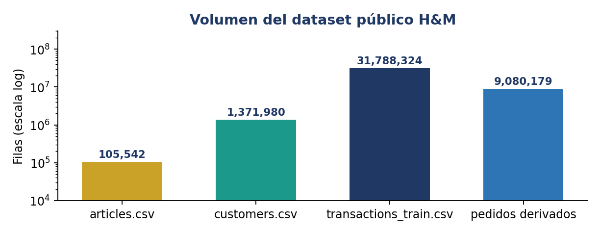</p>

> Los CSV **no se suben a GitHub** (`data/` está en `.gitignore` y la CI lo bloquea). Uso según las reglas de la competencia.

## 🏗️ Arquitectura

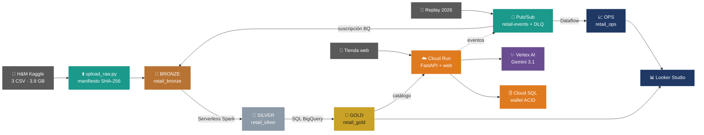

| Capa | Servicio | Por qué |
|---|---|---|
| Almacenamiento | **Cloud Storage** | Barato, versionado, imágenes a Nearline a los 30 días |
| Data warehouse | **BigQuery** | Serverless, tablas externas, particiones y clustering |
| Batch | **Serverless for Apache Spark** | Spark sin clúster; se paga por uso |
| Streaming | **Pub/Sub + Dataflow** | Desacople, ventanas de 1 min, datos tardíos, DLQ |
| API / web | **Cloud Run** | Escala a cero, HTTPS incluido |
| Transaccional | **Cloud SQL Postgres 15** | ACID para checkout y billetera |
| IA | **Vertex AI Gemini 3.1 Flash-Lite** | Misma IAM y factura de GCP, bajo costo |
| IaC / CI | **Terraform + GitHub Actions (WIF)** | Reproducible y sin llaves |

<details><summary>🖼️ Ver la versión en imagen (la misma de la guía técnica)</summary>
<p align="center">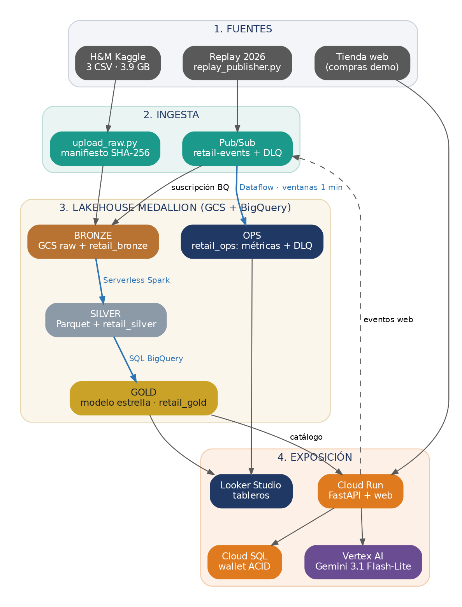</p>
</details>

## 🔄 Pipelines

### A · Batch: Bronze → Silver → Gold

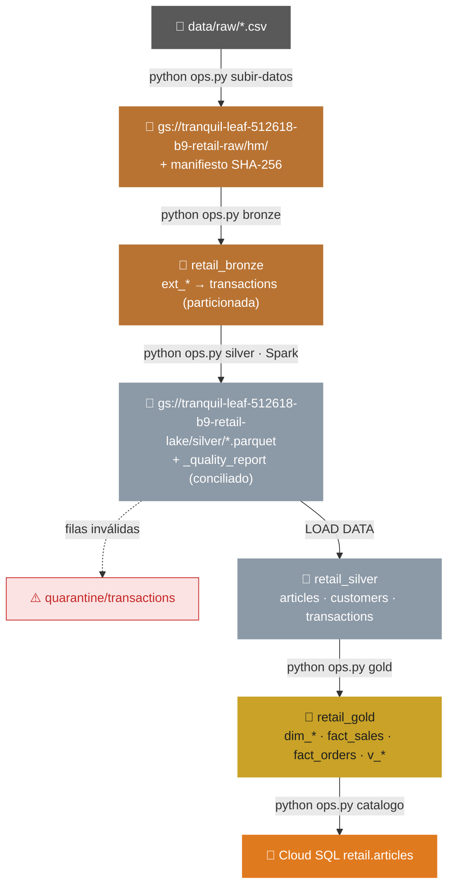

| Etapa | Comando | Código | Resultado verificable |
|---|---|---|---|
| Carga | `python ops.py subir-datos` | `ingestion/batch/upload_raw.py` | Manifiesto con SHA-256 y filas por archivo |
| Bronze | `python ops.py bronze` | `sql/bronze/01_bronze_hm.sql` | 31,788,324 filas en `retail_bronze.transactions` |
| Silver | `python ops.py silver` | `pipelines/batch/silver_hm.py` + `sql/silver/01_load_silver.sql` | `conciliado = true` (entrada = salida + rechazadas) |
| Gold | `python ops.py gold` | `sql/gold/01_gold_model.sql`, `02_kpi_views.sql` | Modelo estrella y vistas BI |
| Catálogo | `python ops.py catalogo` | `api/load_catalog.py` | `/ready` con 105,542 artículos |

### B · Streaming: replay 2026

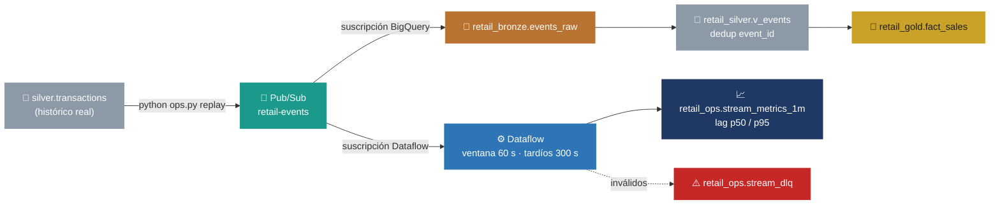

### C · Servicio: API, asistente y tienda

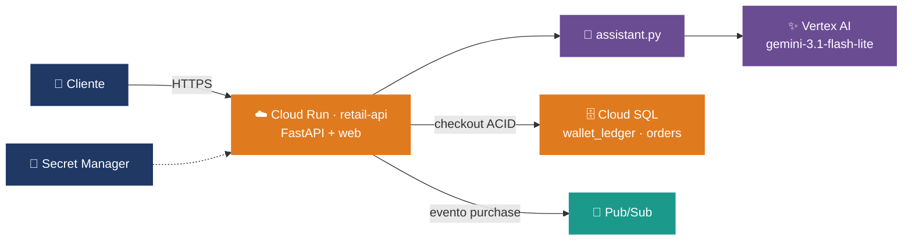

<details><summary>📡 Endpoints de la API</summary>

| Método | Ruta | Función |
|---|---|---|
| GET | `/health`, `/ready` | Salud y catálogo cargado |
| GET | `/api/v1/catalog/products` | Búsqueda en el catálogo |
| POST | `/api/v1/recommendations` | Recomendaciones (cold-start incluido) |
| POST | `/api/v1/assistant/message` | Asistente Gemini con respaldo por reglas |
| GET/POST/DELETE | `/api/v1/cart`, `/api/v1/cart/items` | Carrito |
| POST | `/api/v1/checkout` | Compra ACID idempotente (409 sin saldo) |
| GET/POST | `/api/v1/wallet`, `/api/v1/wallet/demo-topups` | Saldo y recargas demo |
| GET | `/api/v1/orders`, `/api/v1/metrics/summary` | Pedidos y métricas |

</details>

### D · Configuración y CI/CD

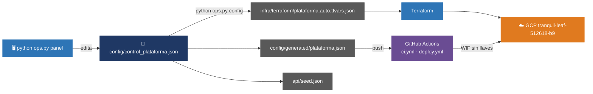

## 🧬 Modelo de datos

<p align="center">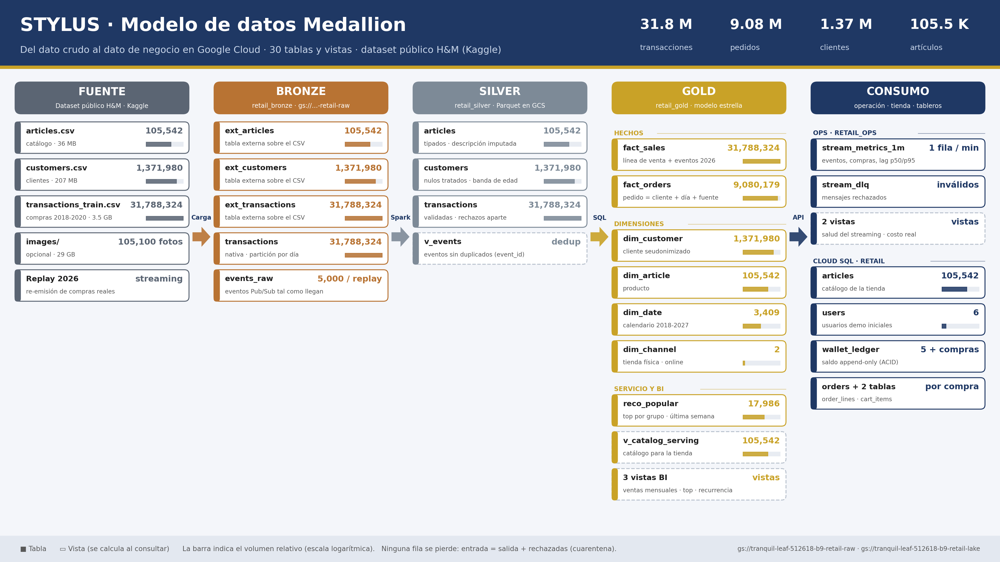</p>

30 tablas y vistas: Bronze (5), Silver (4), Gold (11), OPS (4) y Cloud SQL (6). Gold es un **modelo estrella**:

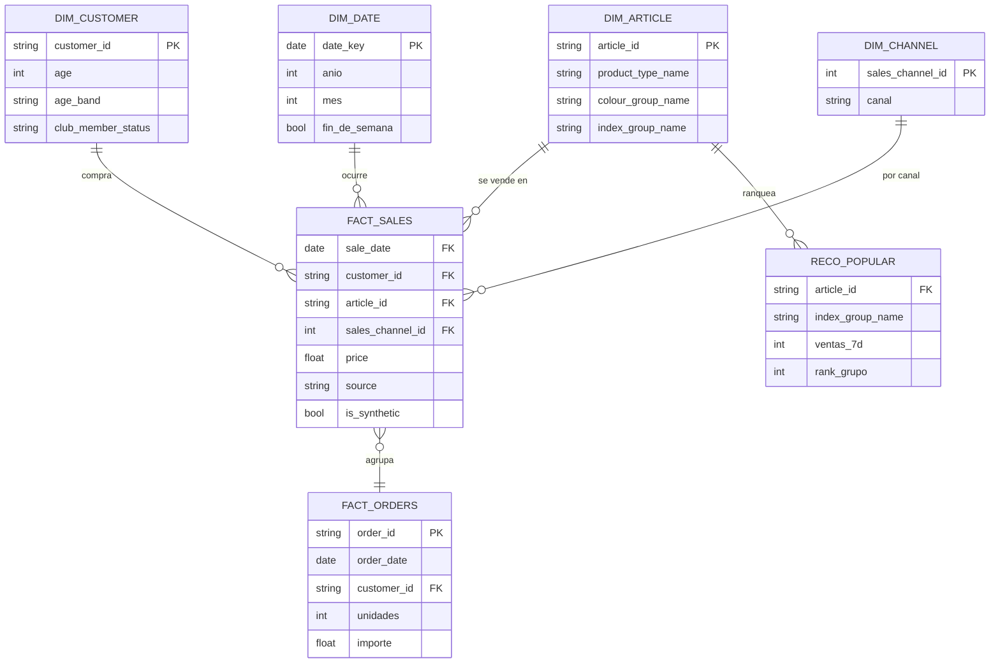

| Tabla | Grano | Origen |
|---|---|---|
| `fact_sales` | 1 línea de venta | Histórico H&M + eventos 2026 |
| `fact_orders` | 1 pedido (cliente + día + fuente; H&M no trae `order_id`) | Agregado de `fact_sales` |
| `dim_customer` / `dim_article` | 1 cliente / 1 artículo | Silver |
| `dim_date` / `dim_channel` | 1 día / 1 canal | Calendario / supuesto documentado |
| `reco_popular` | 1 artículo por grupo | Popularidad de la última semana |

<details><summary>⭐ Diagrama completo con todas las columnas</summary>
<p align="center">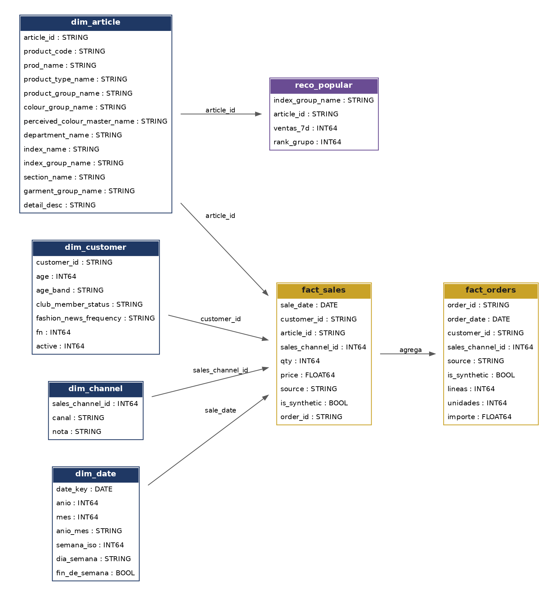</p>
</details>

<details><summary>🎯 Evaluación del recomendador</summary>
<p align="center">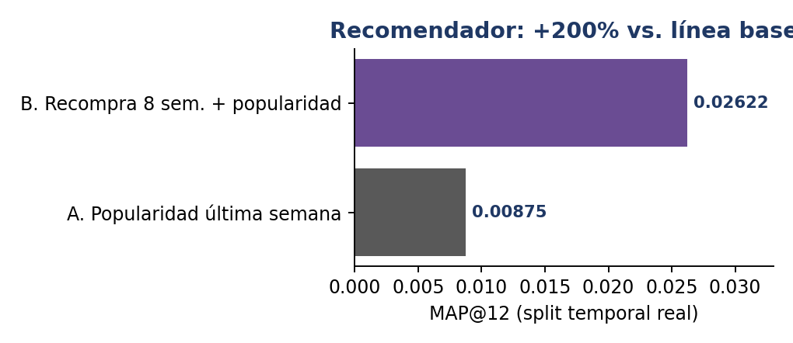</p>

Split temporal real (entrenamiento hasta 2020-09-16, prueba de una semana), 68,984 clientes evaluados. Detalle: [`docs/evaluacion_recomendador.md`](docs/evaluacion_recomendador.md).
</details>

> Esquema columna por columna: `config/control_plataforma.json` y el **Anexo C** de la [guía técnica](docs/entrega1/Guia_Tecnica_STYLUS.pdf).

## 👥 Equipo y roles

| Integrante | Perfil | Responsable de | Tareas |
|---|---|---|---:|
| **Estuardo Oliver** | ML / Analytics | Asistente Gemini, recomendador, documentos, matriz de auditoría, repositorio y costos reales | 11 |
| **Winston Quispe** | Cloud Computing | Terraform, IAM, Pub/Sub, Dataflow, CI/CD, presupuesto, DRP, `ops.py` | 18 |
| **Nicole Arenas** | Datos + API + Modelado | Auditoría de datos, Bronze/Silver/Gold, modelo estrella, FastAPI, Cloud SQL | 13 |
| **Gianmarco Mejia** | Dashboard / BI | Diagramas, calculadora de costos, KPIs, vistas BI, Looker Studio | 9 |

<p align="center">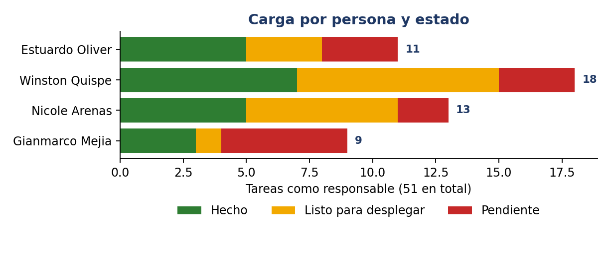</p>

<details><summary>🧭 Matriz RACI por dominio (R = responsable, A = apoyo)</summary>

| Dominio | Estuardo | Winston | Nicole | Gianmarco |
|---|:---:|:---:|:---:|:---:|
| Datos | A | A | **R** |  |
| Gestión | **R** | **R** / A |  | **R** |
| Seguridad |  | **R** |  |  |
| Diseño | A | **R** / A | **R** / A | **R** |
| Costos |  | **R** / A |  | **R** / A |
| Resiliencia |  | **R** | A |  |
| BI | A | A | A | **R** |
| Infra |  | **R** | A |  |
| Modelado | A |  | **R** |  |
| Streaming |  | **R** | A |  |
| ML | **R** |  | A |  |
| API |  | A | **R** | A |

</details>

## 💰 Costos

| Escenario | Uso | Costo / mes | Costo / año | Pedidos / mes | Costo / pedido |
|---|---|---:|---:|---:|---:|
| **Desarrollo** | Equipo trabajando, Dataflow apagado | USD 8.20 | **USD 98.40** | 5,000 | USD 0.00164 |
| **Demo** | Demo en vivo con streaming | USD 11.57 | **USD 138.87** | 20,000 | USD 0.00058 |
| **Producción** | Operación normal (377 mil pedidos/mes) | USD 370.83 | **USD 4,449.95** | 377,000 | USD 0.00098 |
| **Pico Black Friday** | Mes de Black Friday (×5 tráfico) | USD 1,403.21 | **USD 16,838.50** | 1,885,000 | USD 0.00074 |
| **Año 1 realista** | 11 meses de producción + 1 mes pico | — | **USD 5,482.33** | — | — |

<p align="center">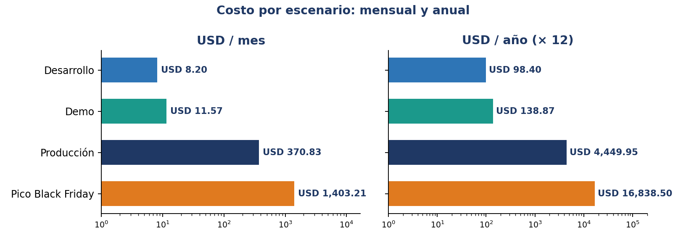</p>

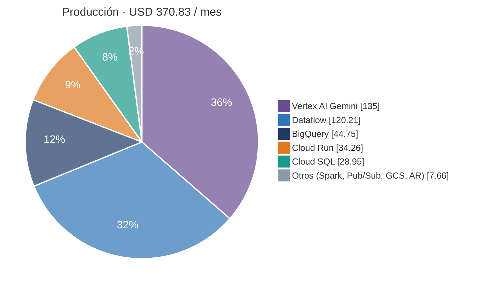

<details><summary>📋 Detalle por servicio en producción (mes y año)</summary>

| Servicio | Costo / mes | Costo / año | % |
|---|---:|---:|---:|
| Vertex AI Gemini 3.1 Flash-Lite | USD 135.00 | USD 1,620.00 | 36% |
| Dataflow | USD 120.21 | USD 1,442.57 | 32% |
| BigQuery | USD 44.75 | USD 537.00 | 12% |
| Cloud Run | USD 34.26 | USD 411.06 | 9% |
| Cloud SQL | USD 28.95 | USD 347.40 | 8% |
| Serverless for Apache Spark | USD 3.60 | USD 43.20 | 1% |
| Cloud Pub/Sub | USD 2.31 | USD 27.71 | 1% |
| Cloud Storage | USD 1.50 | USD 18.00 | 0% |
| Artifact Registry | USD 0.25 | USD 3.00 | 0% |
| **Total** | **USD 370.83** | **USD 4,449.95** | 100% |

<p align="center">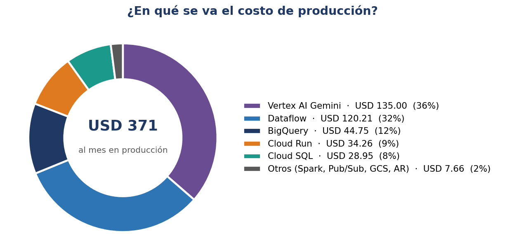</p>
</details>

**Palancas:** Gemini y Dataflow suman el 69% del costo de producción → `assistant_mode = rules` y apagar Dataflow fuera de la demo.
Presupuesto de USD 50/mes con alertas al 50/90/100% (Terraform). Supuestos en `cost/assumptions.yaml`; precios actualizables con `python cost/estimate_costs.py --refresh-prices`.

## 📅 Avance y cronograma

| Entrega | Fecha | Avance |
|---|---|---|
| **1** · Examen + P1: diseño, costos, ingesta/storage | 24-oct-2026 | 🟩🟩🟩🟩🟩🟩🟩🟩🟩🟩🟩🟩🟩🟩🟩🟩🟩🟨🟨🟨🟥 **81%** (17/21) |
| **2** · Pipelines batch + streaming, modelado | 07-nov-2026 | 🟩🟩🟨🟨🟨🟨🟨🟨🟨🟨🟥🟥🟥🟥 **14%** (2/14) |
| **3** · API, asistente, tableros, demo | 20-nov-2026 | 🟩🟨🟨🟨🟨🟨🟨🟨🟥🟥🟥🟥🟥🟥🟥🟥 **6%** (1/16) |

🟩 hecho · 🟨 listo para desplegar (código probado, falta ejecutar en GCP) · 🟥 pendiente

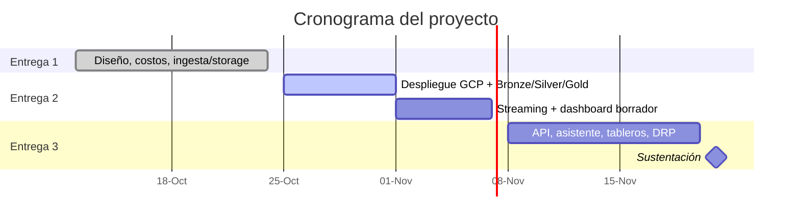

## 🚀 Cómo usarlo

**Panel web (recomendado):** `python ops.py panel` → http://127.0.0.1:8765 — edita la configuración (parámetros, usuarios, permisos, APIs) y ejecuta cada paso con un botón y registro en vivo.

```bash
# Local, sin GCP
pip install -r requirements.txt
python ops.py config                     # valida config/control_plataforma.json y genera lo derivado
python -m unittest discover -s tests     # 7 pruebas
python ops.py local                      # tienda en http://localhost:8080 · OpenAPI en /docs

# Google Cloud (Cloud Shell o PC con gcloud + Terraform)
python ops.py bootstrap && python ops.py plan && python ops.py apply
python ops.py subir-datos                # desde la PC que tiene data/raw
python ops.py bronze && python ops.py silver && python ops.py gold
python ops.py api                        # imagen + Cloud Run + catálogo en Cloud SQL
python ops.py verificar                  # BigQuery real vs. configuración
python ops.py destroy                    # al terminar
```

<details><summary>🔧 Recursos que se crean (nombres reales)</summary>

| Recurso | Nombre |
|---|---|
| Proyecto / región | `tranquil-leaf-512618-b9` · `us-central1` |
| Buckets | `gs://tranquil-leaf-512618-b9-retail-raw` · `gs://tranquil-leaf-512618-b9-retail-lake` |
| Estado de Terraform | `gs://tranquil-leaf-512618-b9-tfstate/retail/dev` |
| Datasets | `retail_bronze` · `retail_gold` · `retail_ops` · `retail_silver` |
| Imagen API | `us-central1-docker.pkg.dev/tranquil-leaf-512618-b9/retail/retail-api` |
| Cuentas de servicio | `sa-retail-api@tranquil-leaf-512618-b9.iam.gserviceaccount.com` · `sa-retail-deployer@tranquil-leaf-512618-b9.iam.gserviceaccount.com` · `sa-retail-ingest@tranquil-leaf-512618-b9.iam.gserviceaccount.com` · `sa-retail-pipeline@tranquil-leaf-512618-b9.iam.gserviceaccount.com` |

</details>

## 📁 Estructura del repositorio

```
config/              Fuente única de configuración (JSON) + archivos generados
panel/               Panel web local: editar configuración y desplegar
ops.py               Orquestador: un comando por paso
infra/terraform/     GCS, BigQuery, Pub/Sub, IAM, Cloud SQL, Cloud Run, WIF, presupuesto
ingestion/           Carga batch (manifiesto SHA-256) y replay de eventos 2026
pipelines/           Spark (Silver), Dataflow (streaming), evaluación del recomendador
sql/                 Bronze, Silver, Gold y vistas BI
api/                 FastAPI, tienda web, asistente Gemini, wallet
cost/                Calculadora y costo real por pedido
docs/                Entregas, guía técnica, arquitectura, despliegue, runbooks
tests/               Pruebas unitarias
data/                SOLO LOCAL (excluido de Git)
```

## 🔒 Reglas y seguridad

- Nunca se versionan datos, credenciales ni `*.tfstate` — lo valida la CI en cada push.
- Contraseñas y tokens viven en **Secret Manager** (los genera Terraform), nunca en la configuración.
- El despliegue desde GitHub usa **Workload Identity Federation**: sin llaves JSON.
- Precio, stock y saldo de la tienda son **simulados**; ninguna compra se ejecuta sin confirmación.
- Datos: [H&M Kaggle](https://www.kaggle.com/competitions/h-and-m-personalized-fashion-recommendations), uso según las reglas de la competencia.

<sub>README generado con `python docs/_generadores/build_readme.py` a partir de los datos reales del repositorio.</sub>
