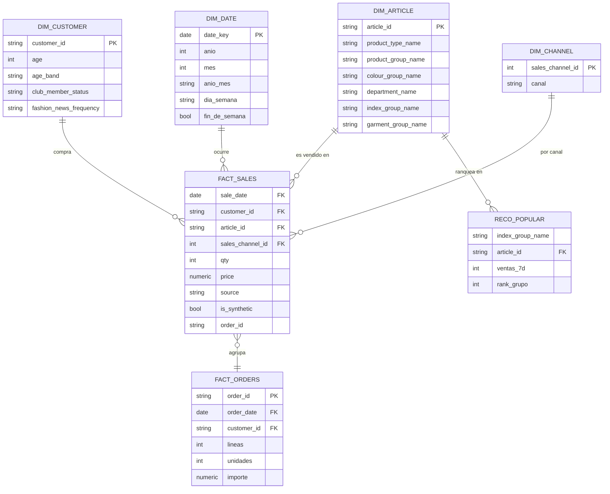

# Retail Intelligence & Personal Shopping Assistant

Plataforma Big Data de retail en **Google Cloud** con datos de **H&M Personalized Fashion Recommendations**:
ingesta batch y streaming, lakehouse medallion (GCS + BigQuery), recomendaciones, asistente con
**Vertex AI Gemini**, tienda web con saldo simulado y control de costos automatizado.
Proyecto final · UTEC Taller de Arquitectura Big Data.

## Fuente de datos

Todo el proyecto corre sobre **datos públicos reales**: el dataset de Kaggle
[H&M Personalized Fashion Recommendations](https://www.kaggle.com/competitions/h-and-m-personalized-fashion-recommendations)
(competencia de H&M Group, 2022). No se usan datos propios, sintéticos de origen ni de ninguna otra fuente para las
entidades base (clientes, artículos, transacciones); lo único generado por el proyecto son los eventos de streaming,
que son **re-emisiones** de esas mismas transacciones reales con fecha de 2026 (marcadas `is_synthetic=true`, ver Reglas).

| Archivo original | Filas | Contenido |
|---|---:|---|
| `articles.csv` | 105,542 | Catálogo de productos (tipo, color, sección, descripción) |
| `customers.csv` | 1,371,980 | Clientes (edad, estado de membresía, frecuencia de noticias) |
| `transactions_train.csv` | 31,788,324 | Compras históricas (cliente, artículo, fecha, precio, canal) |
| `images/` | 105,100 | Fotos de producto (no se usan en este proyecto; excluidas por defecto de la subida) |

Uso sujeto a las reglas de la competencia Kaggle; no se redistribuyen los archivos originales (están en `data/raw`,
excluido de Git).

## Equipo

| Integrante | Perfil | Foco |
|---|---|---|
| Estuardo Oliver | ML / Analytics | Asistente Gemini, recomendaciones, analítica |
| Winston Quispe | Cloud Computing | Terraform, GCP, Pub/Sub, Dataflow, CI/CD, costos |
| Nicole Arenas | Datos + API + Modelado | Bronze/Silver/Gold, modelo estrella, FastAPI, Cloud SQL |
| Gianmarco Mejia | Dashboard / BI | KPIs, Looker Studio, presentación |

| Archivo | Para qué |
|---|---|
| `config/control_plataforma.json` | **Único lugar donde se editan inputs**: parámetros, APIs, cuentas, permisos, usuarios iniciales, datasets, tablas, columnas, secretos |
| `ops.py` | Orquestador: `python ops.py <comando>` (ver `python ops.py -h`) |
| `docs/gestion/Matriz_Auditoria_Proyecto.xlsx` | Tareas, perfiles, pasos 1-2-3 y orden de despliegue |
| [`docs/DEPLOY.md`](docs/DEPLOY.md) | Guía de despliegue |
| `docs/entrega1/Guia_Tecnica_STYLUS.docx` / `.pdf` | Guía técnica completa (arquitectura, pipelines, roles, costos, anexos de esquemas). Se regenera con `python docs/_generadores/build_guia_data.py` y `node docs/_generadores/build_guia.js` |

## Estructura

```
config/                   JSON de control + archivos generados (no editar generated/)
infra/terraform/          GCS, BigQuery, Pub/Sub, IAM, Cloud SQL, Cloud Run, WIF, presupuesto
ingestion/batch/          H&M -> Bronze (GCS) con manifiesto SHA-256
ingestion/streaming/      Replay de transacciones como eventos 2026 -> Pub/Sub
pipelines/batch/          Silver con Spark (Serverless for Apache Spark)
pipelines/streaming/      Dataflow: dedup, ventanas, datos tardíos, DLQ, métricas de lag
pipelines/reco/           Evaluación del recomendador (MAP@12, split temporal)
sql/                      bronze/ silver/ gold/ (modelo estrella y vistas BI)
api/                      FastAPI + web + asistente Gemini + wallet (Cloud Run / Cloud SQL)
cost/                     Calculadora de costos y costo real por pedido
docs/                     Entregas, arquitectura, despliegue, runbooks, demo, diccionario
tests/                    Pruebas unitarias (costos, replay, API)
data/                     SOLO LOCAL (excluido de Git)
```

## Modelo de datos

Bronze conserva los 3 CSV tal cual (una tabla externa por archivo). Silver limpia tipos y agrega los eventos de
streaming. Gold es un **modelo estrella** listo para BI y para la API:



| Tabla (`retail_gold.*`) | Grano | De dónde sale |
|---|---|---|
| `dim_customer` | 1 cliente | `silver.customers` (de `customers.csv`) |
| `dim_article` | 1 artículo | `silver.articles` (de `articles.csv`) |
| `dim_date` | 1 día (2018-2027) | Calendario generado |
| `dim_channel` | 1 canal (Tienda física / Online) | Supuesto propio: H&M no documenta los canales |
| `fact_sales` | 1 línea de venta | `silver.transactions` (histórico, de `transactions_train.csv`) + `silver.v_events` (streaming, re-emisión del mismo histórico) |
| `fact_orders` | 1 pedido (cliente + día + fuente; H&M no trae `order_id`) | Agregado de `fact_sales` |
| `reco_popular` | 1 artículo por grupo | Popularidad de los últimos 7 días, insumo del recomendador baseline |

El esquema completo con tipos de columna está en `config/control_plataforma.json` (sección `tablas`/`columnas`) y se
valida automáticamente contra el SQL real con `python ops.py verificar`. Detalle de cada campo: `docs/diccionario_datos.md`.

## Panel de control (opcional, recomendado)

`python ops.py panel` abre http://127.0.0.1:8765 en tu navegador: edita toda la configuración
y las tablas (usuarios, permisos, cuentas, APIs) y ejecuta cada paso de `ops.py` con un botón, viendo el registro en vivo.
Corre solo en tu máquina (127.0.0.1); no lo expongas a la red. Si editas el JSON a mano, usa un editor que soporte UTF-8
con pestañas por sección. Es la forma recomendada de editar la configuración (en vez de tocar el JSON a mano).

## Inicio rápido (local, sin GCP)

```bash
pip install -r requirements.txt
python ops.py config                          # valida config/control_plataforma.json y genera configuración
python -m unittest discover -s tests          # pruebas
python cost/estimate_costs.py                 # calculadora de costos
python ops.py local                           # tienda en http://localhost:8080 · OpenAPI en /docs
python pipelines/reco/baseline_eval.py        # MAP@12 con datos reales
```

## Despliegue en GCP

Recomendado: Google Cloud Shell (ya trae gcloud, Terraform, Python, Docker). Detalle en `docs/DEPLOY.md`.

```bash
# 1. Editar config/control_plataforma.json (project_id, emails, billing_account, github_repo)
python ops.py config
python ops.py bootstrap && python ops.py plan && python ops.py apply
python ops.py subir-datos          # desde la PC que tiene data/raw
python ops.py bronze && python ops.py silver && python ops.py gold
python ops.py api                  # imagen + Cloud Run + catálogo en Cloud SQL
python ops.py verificar            # BigQuery real vs config/control_plataforma.json
python ops.py destroy              # al terminar
```

## Resultados medidos

| Indicador | Valor |
|---|---|
| Transacciones / pedidos / clientes / artículos | 31,788,324 / 9,080,179 / 1,371,980 / 105,542 |
| MAP@12 popularidad vs recompra + popularidad | 0.00875 vs 0.02622 (+200%) |
| Costo estimado producción | USD 370.83/mes · USD 0.00098 por pedido (Gemini 3.1 Flash-Lite) |

## Reglas

- Nunca versionar datos, credenciales ni `*.tfstate` (lo valida la CI). Contraseñas y tokens: Secret Manager, nunca config/control_plataforma.json.
- Eventos 2026 = re-emisión de transacciones reales: `source_t_dat` conserva la fecha original e `is_synthetic=true`.
- Precio, stock y saldo de la tienda son simulados; ninguna compra se ejecuta sin confirmación explícita.
- Datos: [H&M Kaggle](https://www.kaggle.com/competitions/h-and-m-personalized-fashion-recommendations), uso según las reglas de la competencia.
